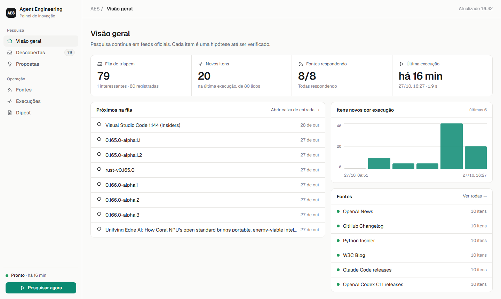
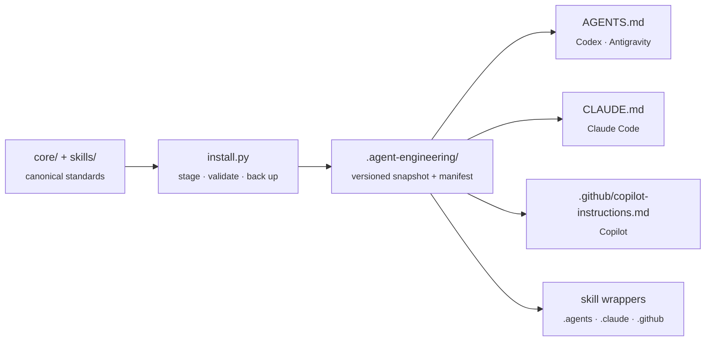
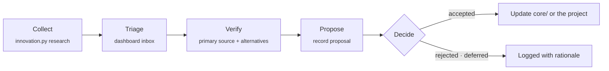
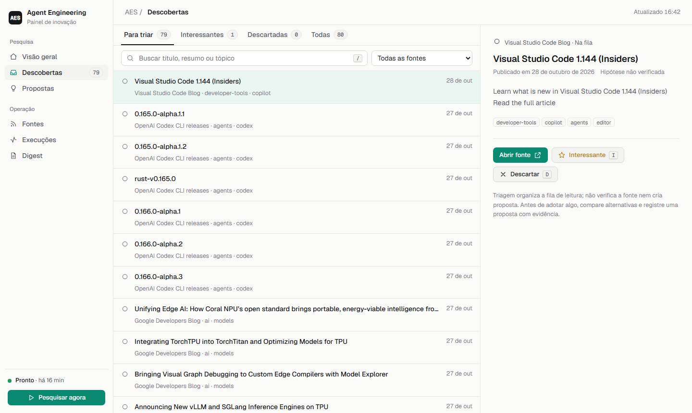

<div align="center">

# Agent Engineering System

**One engineering standard for every coding agent.**

Write your engineering rules once. AES installs them as native instructions and skills for
Codex, Claude Code, Google Antigravity, and GitHub Copilot, then keeps them current with a
reviewed, evidence-based innovation cycle.

[](VERSION)
[](#quick-start)
[](#design-principles)
[](LICENSE)

[Quick start](#quick-start) · [How it works](#how-it-works) · [Innovation cycle](#continuous-innovation-cycle) · [Dashboard](#innovation-dashboard) · [Guia em PDF (pt-BR)](docs/AES-guia-rapido.pdf)

</div>

<br>

<picture>
  <source media="(prefers-color-scheme: dark)" srcset="docs/images/dashboard-overview-dark.png">
  
</picture>

## Why AES

Every coding agent looks for instructions in a different place: `AGENTS.md`, `CLAUDE.md`,
`.github/copilot-instructions.md`, `.agents/rules/`. Hand-maintained copies drift, and agents end up
skipping investigation, tests, or security checks.

AES keeps **one canonical source** of standards and skills, generates **thin native adapters** for
each agent, and merges them into the `CLAUDE.md` or `AGENTS.md` your project already has, inside a
clearly delimited block, without touching anything you wrote.

## Design principles

| | Principle | What it means in practice |
|---|---|---|
| ◆ | **Single source of truth** | Standards live in `core/` and `skills/`. Adapters are generated, never hand-edited. |
| ◆ | **Progressive disclosure** | Short always-on rules; detailed skills load only when a task needs them. |
| ◆ | **Evidence over claims** | Agents report only the checks they actually ran and inspected. |
| ◆ | **Safe installation** | Your instructions are preserved: AES adds a managed block to existing entry points; updates are staged, backed up, and rolled back on failure. |
| ◆ | **Reviewed improvement** | Improvements become proposals with evidence. Nothing rewrites its own rules. |
| ◆ | **Zero dependencies** | Python standard library only. Easy to audit, easy to run anywhere. |

## Quick start

> **Requirements:** Python 3.10+. Nothing else.

```bash
# 1. Validate this repository
python scripts/validate.py
python -m unittest discover -s scripts -p "test_*.py"

# 2. Install into a project (pick the agents your team uses)
python scripts/install.py /path/to/project --agents codex,claude,antigravity,copilot

# 3. Later, pull in a newer AES version
python scripts/install.py /path/to/project --update
```

Then review the diff, commit `.agent-engineering/` and the generated adapters, and open a fresh
agent session to confirm it discovered the instructions.

Already have a `CLAUDE.md` or `AGENTS.md`? AES adds its guidance at the top inside a managed block and
keeps your content below it (after any frontmatter, with your original line endings):

```markdown
<!-- AES:BEGIN · Managed by Agent Engineering System. Edit outside this block; ... -->
@AGENTS.md
...
<!-- AES:END -->

# Your project
- Your existing rules stay here, untouched.
```

## How it works



| Agent | Instruction entry point | Skills |
|---|---|---|
| **Codex** | `AGENTS.md` | `.agents/skills/` |
| **Claude Code** | `CLAUDE.md` importing `AGENTS.md` | `.claude/skills/` wrappers |
| **Google Antigravity** | `AGENTS.md` plus `.agents/rules/` | `.agents/skills/` |
| **GitHub Copilot** | `.github/copilot-instructions.md` | `.github/skills/` wrappers |

Discovery varies by product version, IDE, and harness. Verify effective instruction discovery after installation.

### The workflow agents follow

**Triage → Investigate → Design → Implement → Verify → Review → Improve**, with depth proportional
to risk: *low* (copy, styling), *normal* (a bounded workflow), *high* (auth, payments, personal data,
migrations, integrations), and *production-sensitive* (requires explicit authorization).

### What ships in this repository

```text
core/          Engineering charter, workflow, verification & risk tiers,
               product/UX quality, continuous-improvement protocol, ADRs
skills/        codebase-investigation · architecture-review · implementation-quality
               product-engineering · continuous-improvement
scripts/       install.py      safe install and update
               innovation.py   sensitivity scan, research cycle, evidence register
               gateway.py      bounded OpenAI-compatible model interface (no providers by default)
               dashboard.py    authenticated innovation dashboard
               validate.py · vps_preflight.py
research/      curated RSS/Atom sources and gateway example config
evals/         benchmark tasks and a 0–14 scoring rubric
deployment/    Coolify Dockerfile, systemd template, VPS runbook
docs/          quick-start guide (PDF, pt-BR) and screenshots
```

## Safe updates

Each installed project has `.agent-engineering/manifest.json` with hashes of every managed file.
`--update` then:

- replaces **only the AES block** in `AGENTS.md`, `CLAUDE.md`, and `.github/copilot-instructions.md`; everything outside it stays yours;
- **refuses** to overwrite a managed file, or an AES block, that was changed or removed locally, and names it;
- prepares changes in a staging area, applies them with backups, and **restores** everything if a write fails;
- **retains** files removed from newer AES versions as legacy files instead of deleting them;
- **rejects** symbolic links, escaping manifest paths, malformed manifests, and other unsafe destinations before any write.

> [!NOTE]
> Manifest hashes detect drift relative to the recorded manifest. The manifest is not signed, so an
> attacker who can modify both the manifest and its files is not detected by hashes alone.

Edit standards here, in `core/` and `skills/`. Never treat generated adapter files in a consumer project
as the source of truth.

## Continuous innovation cycle

AES follows official sources (OpenAI, GitHub, Claude Code, Codex CLI, VS Code, Google Developers,
Python, W3C) and turns them into a reading queue. Every lead is a **hypothesis** until someone checks
the primary source.



```bash
python scripts/innovation.py research --per-source 10        # fetch configured feeds, write a digest
python scripts/innovation.py record proposal proposal.json   # append a reviewed proposal revision
python scripts/innovation.py scan path/ --action external_model
```

The research cycle uses HTTPS only, permits only same-host redirects, blocks local and metadata
endpoints, bounds response size and time, prevents overlapping runs, and **never calls a model**.
Feed text is treated as untrusted data. Sources live in [`research/sources.json`](research/sources.json);
record fields are documented in [`research/README.md`](research/README.md).

### Sensitivity gate

Before indexing, summarizing, sending files to an external model, publishing, or sharing, run
`innovation.py scan`. Any finding (private keys, provider tokens, credentials, connection strings,
email addresses, confidentiality markers) or any read/audit error **blocks** the action. Reports and
audit logs contain only paths and detector IDs, never matched values. A clear result means no
configured detector matched; it is not proof that a file is safe.

## From discovery to your projects

AES does not stop at a reading list. An admin picks a discovery in the dashboard and clicks
**Deploy to projects**; AES then:

1. reads the source page (bounded, HTTPS only, contact data and token-like strings redacted),
2. asks the configured model to draft an **Agent Skill** (`SKILL.md`: when to use, how to apply, how to verify, pitfalls),
3. validates the draft (structure, size, sensitivity rules, and a block-list for fetch-and-run, destructive, or exfiltration commands),
4. shows a preview, and on confirmation **commits directly to the default branch** of each selected GitHub repository,
5. records every commit, and can **revert** any repository with one click (a new commit that removes the files).

```text
.agent-engineering/adopted/aes-<skill>/SKILL.md   canonical skill with source and date
.claude/skills/aes-<skill>/SKILL.md               adapter for Claude Code (also .agents/ and .github/ when detected)
.agent-engineering/adopted/README.md              index of active adopted skills
```

Commits contain only those skill files. Feed and article text is untrusted, so AES never writes application
code or executable files to your repositories; your coding agent applies the skill when it works on a task.

| Model provider | Environment variable | Notes |
|---|---|---|
| Anthropic Claude | `ANTHROPIC_API_KEY` | Official SDK, default model `claude-opus-5-5`, server-side refusal fallback |
| Google Gemini | `GEMINI_API_KEY` | OpenAI-compatible endpoint; free tier available |
| DeepSeek | `DEEPSEEK_API_KEY` | OpenAI-compatible endpoint |
| xAI Grok | `XAI_API_KEY` | OpenAI-compatible endpoint |
| OpenAI | `OPENAI_API_KEY` | OpenAI-compatible endpoint |

When a provider key is configured, the dashboard also translates discovery titles and summaries to Brazilian Portuguese in the background (low effort, cached in `research/translations.jsonl`, capped by `AES_MAX_COST_PER_TRANSLATION_BATCH_USD`, default `0.5`); the original text stays one click away.

Choose the provider and model under *AI and GitHub*. Each skill draft is capped by
`AES_MAX_COST_PER_ADOPTION_USD` (default `1.0`). GitHub access uses `AES_GITHUB_TOKEN`, a fine-grained token
limited to the chosen repositories with **Contents: read and write**.

### Ranking and autopilot

Every few minutes the dashboard translates and rates new discoveries, collects community signals, and looks
for fast-rising GitHub repositories in agent, skills, MCP, and design topics. Each discovery gets a 0–100 score:

| Part | Max | From |
|---|---|---|
| Popularity | 50 | Hacker News points and comments; GitHub stars and weekly star growth (repository pages only) |
| Relevance | 40 | The model's 0–10 rating for your registered projects, plus whether it is adoptable at all |
| Authority | 10 | Official source |

Trending repositories must have forks and a description, since bought stars rarely come with either. With the
**autopilot** on (*AI and GitHub*), AES adopts the best items above your score and relevance thresholds, up to a
daily limit, and commits them to every registered project; review and revert them under *Deployments*.
If the selected provider fails, the other configured keys are tried, and *Test connection* shows the provider's error.

## Innovation dashboard

A small authenticated web app (`scripts/dashboard.py`, standard library only) to follow the research
cycle and triage leads.

<picture>
  <source media="(prefers-color-scheme: dark)" srcset="docs/images/dashboard-inbox-dark.png">
  
</picture>

| View | Purpose |
|---|---|
| **Overview** | Triage queue, new items, responding sources, last run, activity chart |
| **Discoveries** | Inbox with search, source and state filters, detail pane, undo |
| **Proposals** | Latest decision per proposal: proposed, accepted, rejected, deferred |
| **Sources** | Per-feed health, topics, and item counts |
| **Runs** | Cycle history with duration, items read, new items, and errors |
| **Digest** | The day's Markdown digest, one section per run |

Keyboard: <kbd>/</kbd> search · <kbd>J</kbd>/<kbd>K</kbd> move · <kbd>I</kbd> interesting ·
<kbd>D</kbd> dismiss · <kbd>U</kbd> back to queue · <kbd>O</kbd> open source.

### Users and access

The dashboard has a sign-in page, multiple accounts, and two roles: **admins** manage users, while
**members** use the panel, triage, and start research. Sessions use `HttpOnly`, `Secure`,
`SameSite=Strict` cookies; passwords are stored as salted PBKDF2-SHA256 hashes; five failed sign-ins lock
the account for five minutes; and sign-ins and user changes are audited without secrets.

| Task | How |
|---|---|
| **Create a user** | *Users → New user*. AES shows a one-time temporary password; the person sets their own on first sign-in. |
| **Change your password** | *My account → Change password*. Other sessions for that account are signed out. |
| **Forgot password** | An admin clicks *Reset password* and shares the new temporary password. |
| **Locked out as admin** | Sign in with the recovery account, or run `python scripts/dashboard.py users reset <name>` in the container. |
| **Sign out** | The button next to your name in the sidebar. |

The **recovery account** comes from `AES_DASHBOARD_USER` (default `aes`) and `AES_DASHBOARD_PASSWORD`
(24+ characters; the app refuses to start without it). It is always an admin and is managed only in the
host's secret environment variables. Other accounts are stored in the state volume at
`private/dashboard-users.json`. Sessions live in memory, so a restart signs everyone out.

```bash
python scripts/dashboard.py users list                 # also: add <name> [--admin] · reset <name> · delete <name>
python -c "import secrets; print(secrets.token_urlsafe(32))"   # generate a strong recovery password
```

Deployment on Coolify, the scheduled weekly task, persistent storage, and backups are covered in
[`deployment/README.md`](deployment/README.md).

## Measuring impact

[`evals/benchmark-tasks.md`](evals/benchmark-tasks.md) defines seven representative scenarios and a
0–14 rubric (investigation, requirement depth, architecture, verification, product quality, scope
discipline, learning). Run the same tasks before and after changing AES. Scores support comparison;
they do not replace reviewing the actual code.

## Limitations

AES does not guarantee that an agent follows instructions; tests and human review remain necessary.
It does not verify product claims, run experiments, update dependencies, or deploy on its own. Adopted
skills reach consumer repositories only after an admin confirms a preview, and only as `SKILL.md` files. The research command is one bounded cycle; schedule it
externally. The model gateway ships with no providers configured.

## Documentation

| Document | |
|---|---|
| [Quick-start guide (PDF, pt-BR)](docs/AES-guia-rapido.pdf) | What AES is, how to install it, and how to use the innovation cycle |
| [`core/`](core/) | The canonical engineering standards |
| [`research/README.md`](research/README.md) | Research register schema and model gateway |
| [`deployment/README.md`](deployment/README.md) | VPS preflight, systemd template, Coolify deployment |
| [`core/ADR-0001-single-canonical-source.md`](core/ADR-0001-single-canonical-source.md) | Why one canonical source with generated adapters |

<div align="center">
<br>
<sub>MIT licensed · Built for teams that want coding agents to engineer, not just generate code.</sub>
</div>
